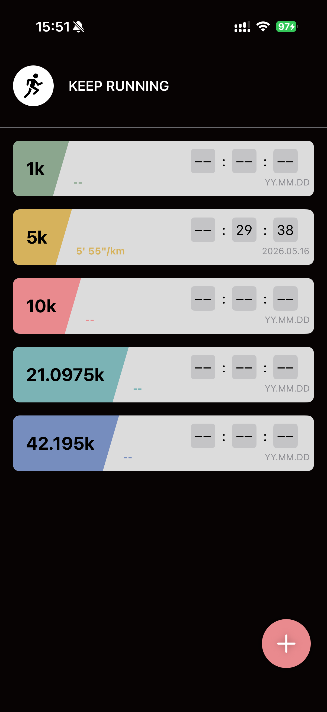
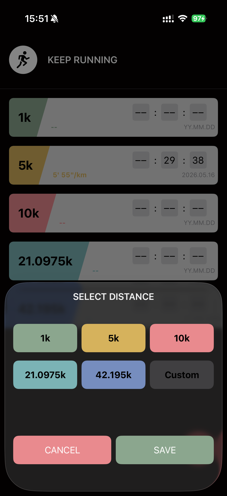
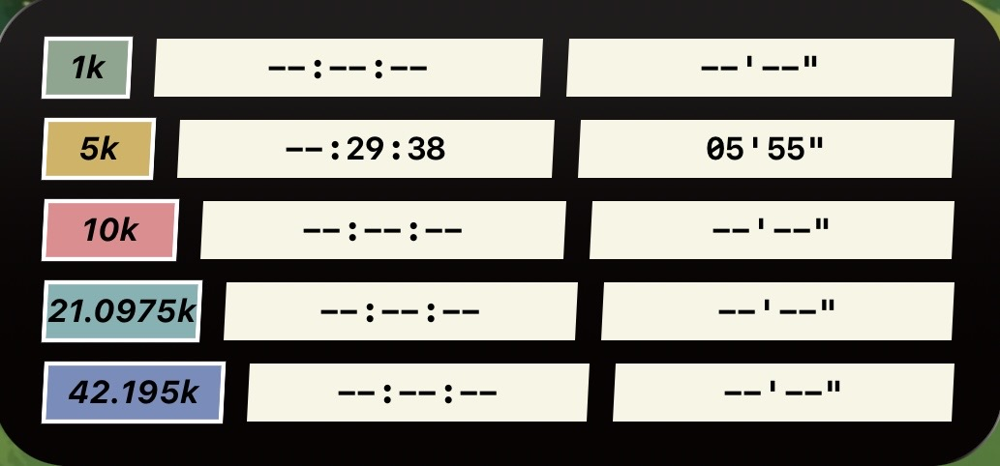

# Keep Running (pber)

**Keep Running** 是一款专为跑步爱好者打造的个人记录和目标配速管理应用（iOS）。通过简洁直观的“仪表盘”界面，用户可以快速设置不同距离（如 1k, 5k, 10k, 半马, 全马及自定义距离）的目标时间，并实时查看对应的配速。

## 核心功能
* **Activity Dashboard**：展示用户已添加的各个跑步距离及其目标配速信息，设计了独特的倾斜式颜色卡片进行区分。
* **自定义记录管理**：支持自定义跑步距离，支持左右拖拽排序和滑动删除。
* **平滑动画与交互**：编辑目标时间时，选中的卡片会自动居中高亮并呈现优雅的动画过渡，同时配有沉浸式的背景遮罩。
* **数据持久化**：所有的距离卡片及时间设置都会以 JSON 格式安全地保存于本地，下次打开时状态不会丢失。
* **小组件支持 (Widget)**：提供 iOS 桌面小组件，方便随时随地在主屏幕上查看设定的跑步距离、时间与配速。

## 历史版本截屏 (ver 0.1)
本项目的前期设计和实现效果，可参考以下截屏：

- 
- 
- 